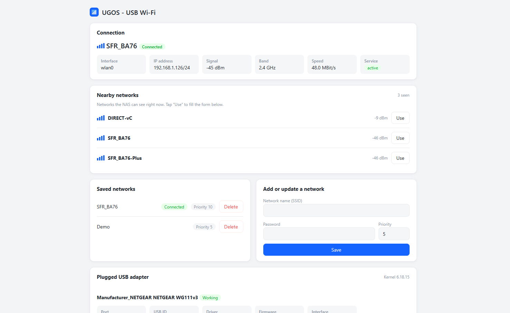

# UGOS · USB Wi-Fi for Ugreen NAS

Connect a Ugreen NAS (UGOS Pro) to Wi-Fi with a USB dongle, and manage it from a small white web page on your local network — no SSH needed after setup.



> Status: Tested end-to-end DXP4800 Plus, UGOS Pro / Debian 12, kernel 6.18.15.

## One-shot install

On the NAS, over SSH (no `git` needed, uses `curl`):

```bash
curl -fsSL https://github.com/clementp0/usb-wifi-ugos-dxp4800/archive/refs/heads/main.tar.gz | tar xz && cd usb-wifi-ugos-dxp4800-main && sudo bash install.sh
```

This opens an interactive menu (English / French):

```
  1  Check the Wi-Fi adapter (detect + status)
  2  Show drivers / firmware (plugged devices)
  3  List compatible cards for this NAS
  4  Install web UI
  5  Add a desktop icon (Docker)
  6  Uninstall web UI
  7  Exit
```

Pick **Install web UI**. It asks for a password, sets up the Wi-Fi service and the UI, and prints the address to open — plus a **one-click first-login link** that logs you in once then expires:

```
  http://192.168.1.126:8088/?token=…      (works once)
  http://192.168.1.126:8088               (then sign in with the password)
  http://DXP4800PLUS.local:8088           (name, survives IP changes)
```

Navigate the menu with ↑/↓ and Enter, or press the number directly. Each action is also available non-interactively: `sudo bash install.sh install | uninstall | check | drivers | compatible`.

## What you get

- **Persistent Wi-Fi** via `wpa_supplicant` + a `systemd` service that starts on any `wl*` interface, so a new dongle just works after plugging in.
- **A local web page** (`http://<nas>.local:8088`) to:
  - see the live connection (SSID, signal, band, speed, IP) and the **nearby networks** (auto-refreshed),
  - add / remove / prioritise saved networks,
  - inspect the **plugged USB adapter** (driver, firmware, verdict),
  - list the **drivers available on this NAS** — a safe "shopping list" of chipsets the kernel can already drive,
  - switch language (FR / EN).
- **Local-only by design**: the UI serves on its own port (8088), which UGREENlink never relays; it refuses non-LAN addresses, asks for a password, and locks out brute-force (5 tries → 5 min). You sign in once per device (180-day session).

## Security model

- Listens on port **8088** only; UGREENlink relays only declared UGOS services, so this port is never reachable from outside your LAN.
- Every request is checked against private/loopback/link-local ranges — a non-LAN client gets `403`.
- Password login → a session cookie derived from the password (changing the password signs everyone out). The one-time setup token is destroyed on first use.
- ⚠️ Port 8088 is plain HTTP, so the password crosses your LAN unencrypted. Keep it on a trusted network; never port-forward 8088 to the internet.

## Optional: a desktop icon (via Docker)

UGOS can only pin a desktop shortcut from a Docker container, so this creates a tiny `nginx:alpine` container that just **302-redirects** to the web UI. Requires Container Manager (Docker) from the UGOS App Center.

Easiest: menu option **5** ("Add a desktop icon (Docker)"), or the prompt shown at the end of an install. It asks whether to point the icon at the NAS **name** (`http://<nas>.local:8088`) or its **IP** (`http://<ip>:8088`), then:

- UGOS → Docker → select **`usbwifi-link`** → **Add to desktop**.

It's **volume-independent**: the nginx config is generated inside the container, so it works no matter which volume Docker lives on — nothing is written to the host. The redirect targets a LAN address, so the icon fails remotely by design.

Standalone equivalent:

```bash
sudo bash desktop-shortcut/setup-docker-link.sh                 # name (<hostname>.local)
sudo bash desktop-shortcut/setup-docker-link.sh 192.168.1.126   # or a fixed IP
```

## Compatibility (kernel 6.18.15, UGOS Pro / Debian 12)

Run menu option **3** ("List compatible cards for this NAS") to see which of these your kernel can drive right now:

| Chipset | Driver | Example dongle | Verdict |
| --- | --- | --- | --- |
| MediaTek MT7921AU (Wi-Fi 6) | `mt7921u` | BrosTrend AX9L (AXE3000) | kernel-ready, not yet tested here |
| MediaTek MT7612U (AC1200) | `mt76x2u` | Alfa AWUS036ACM, Netgear A6210 | kernel-ready, not yet tested here |
| MediaTek MT7610U (AC600) | `mt76x0u` | Panda PAU0B | reported working but slow (Reddit) |
| Realtek RTL8822BU (AC1300) | `rtw88_8822bu` | TP-Link Archer T3U Plus | driver present; unverified |
| Realtek RTL8187 (54 Mbit/s) | `rtl8187` | Netgear WG111v3 | **tested, works, slow** |
| Atheros AR9271 (2.4 GHz) | `ath9k_htc` | Alfa AWUS036NHA, TP-Link TL-WN722N v1 | kernel-ready, not yet tested here |

Check your own kernel before buying:

```bash
ls /lib/modules/$(uname -r)/kernel/drivers/net/wireless/mediatek/mt76/
```

## Uninstall

From the menu (option **5**), or directly:

```bash
sudo bash uninstall.sh          # remove the web UI only
sudo bash uninstall.sh --all    # also remove the Wi-Fi auto-connect service (keeps your saved networks)
```

## Layout

- `install.sh` — interactive installer / toolbox (menu, diagnostics, install, uninstall).
- `uninstall.sh` — thin wrapper around the installer's uninstall action.
- `wifi-auto/` — the base Wi-Fi `systemd` service, udev rule, and a `wifi-nas.conf` template.
- `ui/` — the web UI (`wifi-ui.py`, `index.html`, service). See `ui/README.md` for manual setup and options.
- `desktop-shortcut/` — the optional Docker redirect helper.

---

*Unofficial, community-made. Undocumented UGOS internals may change with updates. Proceed at your own risk.*
